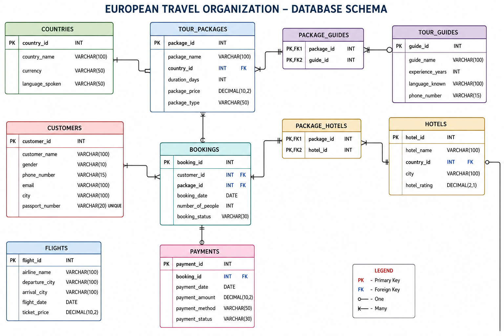

 European Travel Organization Database

A relational database for a travel company that sells European tour packages. It stores customers, bookings, payments, hotels, tour guides and flights. Built with **Oracle SQL**.

## Project Files

| File | Description |
|------|-------------|
| `01_create_tables.sql` | Creates all 10 tables (DDL) |
| `02_insert_data.sql` | Inserts sample data (DML) |
| `er_diagram.png` | Entity-relationship diagram |

## Database Tables

| Table | Purpose |
|-------|---------|
| COUNTRIES | Countries, currency and language |
| TOUR_PACKAGES | Tour packages with price, duration and type |
| TOUR_GUIDES | Guide details and languages known |
| PACKAGE_GUIDES | Links packages to guides (many-to-many) |
| CUSTOMERS | Customer contact and passport details |
| BOOKINGS | Customer bookings for packages |
| HOTELS | Hotels with city and rating |
| PACKAGE_HOTELS | Links packages to hotels (many-to-many) |
| PAYMENTS | Payments made for bookings |
| FLIGHTS | Flight schedules and ticket prices |

## ER Diagram



## How to Run

1. Open Oracle SQL Developer, SQL*Plus or Oracle Live SQL.
2. Run `01_create_tables.sql` to create the tables.
3. Run `02_insert_data.sql` to load the sample data.

The scripts must be run in this order because the tables depend on each other through foreign keys.

## Sample Queries

**Bookings with customer and package names**
```sql
SELECT c.customer_name, p.package_name, b.booking_status
FROM bookings b
JOIN customers c ON b.customer_id = c.customer_id
JOIN tour_packages p ON b.package_id = p.package_id;
```

**Total revenue from successful payments**
```sql
SELECT SUM(payment_amount) AS total_revenue
FROM payments
WHERE payment_status = 'Successful';
```

## Tools Used

- Oracle SQL

## Author

Your Name
